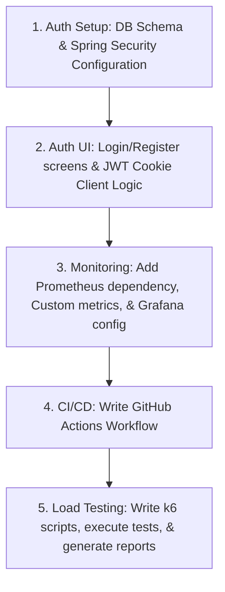

# 🚀 VectorLink Production Upgrade Plan

This document outlines the architecture, database design, and step-by-step implementation strategy for upgrading **VectorLink** to a professional, enterprise-grade system.

---

## 📋 Architectural Overview

We will implement four core upgrades:
1. **User Accounts & JWT/OAuth2 Authentication**: Secure access, user registration, and personal dashboards.
2. **Prometheus + Grafana Monitoring**: Real-time observability of JVM, system health, and custom metrics (latency, cache hit/miss).
3. **k6 Load Testing**: JavaScript-based load-testing scenarios (smoke, load, stress, and spike resilience) with report generation.
4. **CI/CD Pipeline via GitHub Actions**: Automated builds, test execution, style checking, and Docker image publication.

---

## 🔐 1. JWT Authentication & User Accounts

We will transition the application from a public-only system to a multi-tenant dashboard where users own and monitor their specific URLs, while retaining support for anonymous guest redirection.

### Database Schema Changes
We will create a `users` table and link `short_urls` to it:

```sql
-- Create users table
CREATE TABLE IF NOT EXISTS users (
    id BIGSERIAL PRIMARY KEY,
    email VARCHAR(255) UNIQUE NOT NULL,
    password_hash VARCHAR(255) NULL, -- Nullable for OAuth-only users
    provider VARCHAR(20) NOT NULL,    -- LOCAL, GITHUB, GOOGLE
    provider_id VARCHAR(255) NULL,   -- Social login unique ID
    role VARCHAR(20) DEFAULT 'USER' NOT NULL,
    created_at TIMESTAMP WITH TIME ZONE DEFAULT CURRENT_TIMESTAMP NOT NULL
);

-- Link short_urls to users (nullable for guest/anonymous links)
ALTER TABLE short_urls ADD COLUMN IF NOT EXISTS user_id BIGINT REFERENCES users(id) ON DELETE SET NULL;
CREATE INDEX IF NOT EXISTS idx_short_urls_user_id ON short_urls(user_id);
```

### Authentication Architecture
* **Spring Security & OAuth2 Client**: We will configure standard filters allowing public access to redirections (`/{shortCode}`) and static UI pages, while protecting `/api/v1/urls/**` management endpoints.
* **Security Flows**:
  * **Local Flow**: Users register and log in with email/password. Password hashing is performed using **BCrypt**.
  * **OAuth2 Flow**: Users log in using GitHub or Google.
  * **Token Delivery**: On successful authentication (Local or OAuth2), the server generates a signed **JWT (JSON Web Token)** containing the user's ID and role, and delivers it via a secure, **HttpOnly, SameSite=Strict Cookie**. This fully protects the frontend against XSS token theft while keeping JS code simple (the browser automatically includes the cookie on all API requests).

### UI Integration
* New `login.html` & `register.html` static pages featuring a clean, minimal design matching our glassmorphism layout.
* Dashboard updates: If no JWT cookie is present, redirect to login page. Dashboard listings will fetch only URLs belonging to the logged-in user.

---

## 📊 2. Prometheus + Grafana Monitoring

For full-stack observability, we will capture both low-level JVM/container metrics and high-level application metrics.

### Custom Metrics (Micrometer Registry Prometheus)
We will register custom meters inside `UrlShortenerService` and `AnalyticsConsumerService`:
* `vectorlink_redirects_total`: Counter tracking total redirects, tagged by `device`, `browser`, and `status` (success/expired).
* `vectorlink_redirect_latency_seconds`: Timer/Histogram measuring redirect time to monitor P95/P99 latency.
* `vectorlink_cache_hits_total` / `vectorlink_cache_misses_total`: Counters to monitor the effectiveness of L1 (Caffeine) and L2 (Redis) caches.
* `vectorlink_kafka_fallback_buffer_size`: Gauge reporting the current size of the click event recovery queue when Kafka is offline.

### Monitoring Infrastructure
We will add Prometheus and Grafana containers to `docker-compose.yml`:
* **Prometheus**: Configured to scrape Spring Boot's `/actuator/prometheus` endpoint every 10 seconds.
* **Grafana**: Pre-loaded with:
  1. A standard JVM/SpringBoot dashboard (CPU, Memory, Threads, GC).
  2. A custom **VectorLink Operations Dashboard** showing cache hit rates, P99 redirect latency, and Kafka fallback buffer metrics.

---

## ⚡ 3. Load Testing with k6

We will write scriptable load tests using **k6** to validate system performance boundaries and verify L1/L2 cache and Kafka fallback queue resilience.

### Test Scenarios (`/load-tests`)
* **`smoke.js`**: Verify system API endpoints behave correctly under minimal load (1 virtual user).
* **`load_test.js`**: Simulates average traffic (e.g., 50-100 VUs ramping up over 5 minutes) to ensure target latencies (redirects under 10ms) are maintained.
* **`stress_test.js`**: Ramps traffic to 1,000+ concurrent VUs to identify system resource saturation (DB pool depletion, CPU bottlenecks).
* **`spike_resilience.js`**: Instantly injects a traffic burst (1,500 VUs) to verify that if Redis/Kafka experiences momentary congestion, the application correctly falls back to L1 (Caffeine) caches and the memory recovery buffer without losing requests.

---

## 🛠️ 4. GitHub Actions CI/CD Pipeline

We will configure a GitHub Actions workflow (`.github/workflows/ci-cd.yml`) to ensure code quality and seamless integration:

### Pipeline Stages
1. **Lint & Format Check**: Validates code compliance (Checkstyle).
2. **Build & Test**:
   * Spins up Postgres, Redis, and Kafka service containers inside the runner environment.
   * Compiles the Spring Boot project and runs all unit and integration tests (`mvn clean verify`).
3. **Docker Packaging**:
   * On merge to `main`, builds the production multi-stage Docker image.
   * Publishes the image to **GitHub Container Registry (GHCR)** or **Docker Hub**, tagged with the commit SHA and `latest`.

---

## 🗺️ Execution Roadmap



### Let's Discuss:
* **JWT Storage**: Are you comfortable using secure **HttpOnly Cookies** for JWT storage, or would you prefer typical **bearer tokens in LocalStorage**? (Cookies are recommended for security).
* **OAuth2 Providers**: Shall we focus on **GitHub** and **Google** integration?
* **Load testing target**: Do you want to run k6 locally or package it as a Docker service inside our compose file?
